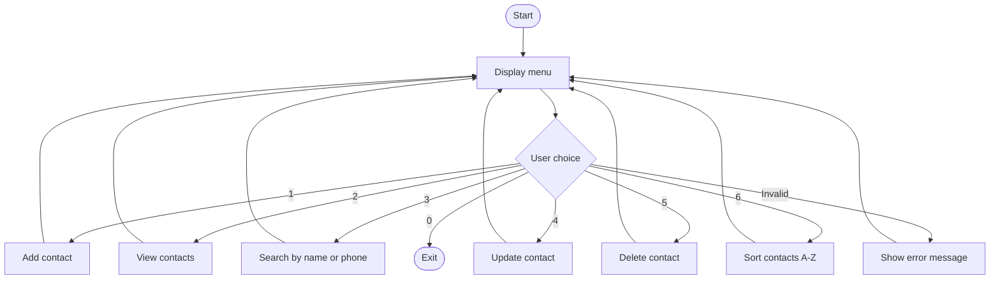

# Contact Management App — Group Workshop Report

**Workshop:** Java Arrays & Collections — Contact Management App  
**Date:** 22 October 2026  
**Meeting:** Online group discussion, starting at approximately 09:30  
**Group members:** Padma, Tuku, Janin, Veselina, Anas and Carl  
**Repository:** [contact-management-workshop](https://github.com/jackaldzn-blip/contact-management-workshop)

## 1. Introduction

Our group developed a console-based Contact Management App in Java. The workshop focused on applying Java Collections and basic object-oriented programming while practising discussion, teamwork, GitHub collaboration and manual testing.

We aimed to keep the application small and understandable so everyone could participate in the planning and implementation.

## 2. Group discussion and planning

We met online at approximately **09:30**. It was an open discussion in which everyone had the opportunity to suggest features, ask questions and share opinions on the design.

We discussed what information each contact should contain, which actions the user would need, and how to organise the code. We agreed to represent each contact with a **name, phone number and optional email**, and to store contacts in an **`ArrayList`**. We also agreed to use a simple text menu and separate methods for the different operations.

### Agreed application menu

```text
=== CONTACT MANAGEMENT ===
1. Add contact
2. View contacts
3. Search contacts
4. Update contact
5. Delete contact
6. Sort A-Z (challenge)
0. Exit
Choose:
```

The first five options provide the main contact-management functionality. **Option 6 implements Optional Challenge 1: Sort Contacts Alphabetically.**

## 3. Flowchart and agreed workflow

Based on our discussion, **Padma prepared a working flowchart**. We reviewed the proposed workflow as a group, discussed it and agreed to use it as the basis for development.

The following simplified diagram represents the agreed application flow and matches the final menu:



After completing an operation, the program returns to the menu. Selecting **0** ends the application.

## 4. Proposed and implemented code structure

To avoid unnecessary complexity, we kept the application in **one source file**, as requested in the workshop:

```text
contact-management-workshop/
├── README.md
└── src/
    └── main/
        └── java/
            └── se/
                └── lexicon/
                    └── ContactApp.java
```

The file contains a nested **`Contact`** class, the shared **`ArrayList<Contact>`**, the menu and its operations. We discussed class design, variable declarations, method names and program logic during implementation.

| Part | Responsibility |
| --- | --- |
| `Contact` | Holds a contact's name, phone and email; provides a readable `toString()` |
| `contacts` | Stores the contacts in an `ArrayList` while the program is running |
| `main()` and `showMenu()` | Display the menu and direct the user's choice |
| `addContact()` | Add a contact after checking required fields and duplicate phone numbers |
| `viewContacts()` | Display the saved contacts |
| `searchContacts()` | Search by name or phone |
| `updateContact()` | Change an existing contact's details |
| `deleteContact()` | Remove a contact by phone number |
| `sortContacts()` | Display contacts in alphabetical order (Challenge 1) |
| `findByPhone()` and `printContacts()` | Reusable methods for lookup and display |

We used one shared plan rather than requiring every member to write identical code. Individual approaches could differ while still meeting the same requirements. Contact data is held **in memory only**; saving to a file was not part of our selected challenge.

## 5. Coordination and GitHub collaboration

**Tuku** coordinated the project setup, established the shared GitHub repository and invited the other members as collaborators. All group members cloned the repository and worked on their own local copies.

We continued our discussions while coding, helping each other understand Java classes, variables, loops, collections and method implementations. GitHub gave us a common location for the project files and made it possible to share our work.

For the optional sorting challenge, we also used a separate branch, **`feature/sort-contacts`**, and merged the completed change into `main` through [Pull Request #1](https://github.com/jackaldzn-blip/contact-management-workshop/pull/1).

## 6. Optional Challenge 1 — Sort Contacts Alphabetically

In addition to the core functionality, we implemented **Challenge 1: Sort Contacts**, which displays the contacts alphabetically by name.

The program copies the contact list and sorts the copy using `sort()` and `compareToIgnoreCase()`. This keeps the original list order unchanged while showing an A–Z result.

For example, if the contacts are added in this order:

```text
Zara
Anna
Omar
```

Option **6 — Sort A-Z** displays:

```text
Anna
Omar
Zara
```

This challenge gave us additional practice using Java Collections and comparing strings.

## 7. Manual testing and results

After implementation, **Janin and Veselina** tested the menu options manually. We chose manual testing to keep the focus on the workshop's Java concepts rather than adding a separate testing framework.

The group reported that the tested operations worked as expected:

| Menu option | Manual check | Reported result |
| --- | --- | --- |
| 1 — Add | Enter a new contact | **Passed** |
| 2 — View | Display the list of contacts | **Passed** |
| 3 — Search | Find a contact by name or phone | **Passed** |
| 4 — Update | Change an existing contact | **Passed** |
| 5 — Delete | Remove a contact | **Passed** |
| 6 — Sort A–Z | Display contacts alphabetically | **Passed** |
| 0 — Exit | Close the application through the menu | **Passed** |

**Testing note:** These results summarise the group's reported manual checks; they are not JUnit results or a separate automated test run. The application also includes basic checks for empty required fields, duplicate phone numbers, missing contacts and invalid menu choices.

## 8. Group participation

| Member | Contribution |
| --- | --- |
| **Padma** | Prepared the working flowchart based on the discussion and reviewed it with the group |
| **Tuku** | Coordinated the project, set up the shared repository and invited collaborators |
| **Janin** | Manually tested the application's menu operations |
| **Veselina** | Manually tested the application's menu operations |
| **Anas** | Participated in planning and implementation discussions; co-authored the final report |
| **Carl** | Participated in planning and implementation discussions; co-authored the final report |

**All six members** took part in the initial discussion, worked with local project copies and communicated during implementation. The roles in the table describe particular responsibilities, not the full extent of each person's participation.

## 9. Reflection and conclusion

The main challenge was coordinating work across six members while allowing room for different programming approaches. Our shared discussion, menu design and flowchart provided a common starting point. Working through the implementation also helped us understand why methods, variables and collections should be organised clearly.

We completed a simple contact-management application with the agreed core operations and **Optional Challenge 1 (alphabetical sorting)**. The workshop gave us practical experience with `ArrayList`, classes, methods, loops, conditional statements, console input, manual testing and GitHub collaboration.

**Final project:** https://github.com/jackaldzn-blip/contact-management-workshop