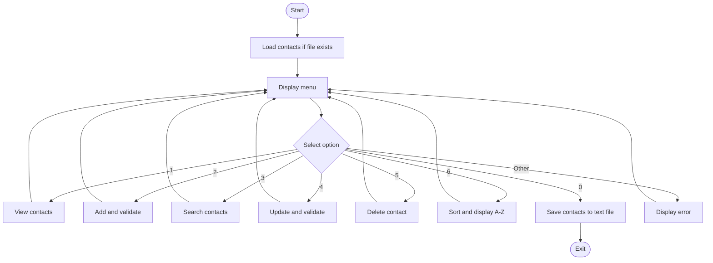

# Contact Management App — Group Workshop Report

**Workshop:** Java Arrays & Collections — Contact Management App  
**Date:** 22 October 2026  
**Meeting:** Online, from approximately 09:30  
**Members:** Padma, Tuku, Jay, Veselina, Anas and Carl  
**Shared project:** https://github.com/jackaldzn-blip/contact-management-workshop

## 1. Discussion and planning

We met online at approximately **09:30** for an open group discussion. Everyone was able to share opinions about the requirements, contact information, menu operations and how to organise the application. We agreed on the **same basic functionality, menu and core program structure**, but members could use different Java implementations in their **own repositories**. Having different approaches was acceptable because the workshop focused on discussing, learning and reaching the same functional goal.

**Padma** prepared a working flowchart from the group discussion. We reviewed it, suggested changes and agreed on the application flow before starting development. **Tuku** coordinated the shared GitHub setup and invited collaborators. During our discussion, we also considered the importance of input validation: the application should not accept incorrect contact details or unexpected input. As a group, we agreed to include simple validation without making the program unnecessarily complicated.

## 2. Agreed functionality and menu

The shared final version contains:

```text
=== CONTACT MANAGEMENT ===
1. View contacts
2. Add contact
3. Search contacts
4. Update contact
5. Delete contact
6. Sort contacts A-Z (Challenge 1)
0. Save and exit (Challenge 3)
```

Each contact has an ID, first name, last name, phone number and optional email address. We selected a Java Collection (`LinkedHashMap<Integer, Contact>`) to keep contacts accessible by ID and in insertion order. Phone numbers are stored as `String` to retain leading zeroes.

### Input validation — group discussion and implementation

As part of our planning, **we discussed why validation matters**: without it, a user could accidentally save empty names, an invalid phone number, or duplicate contact details. We agreed as a group to implement straightforward checks in `ContactService.java` and handle invalid menu/ID entries in `ContactApp.java`.

| Input | Agreed and implemented check |
| --- | --- |
| First and last name | Required; must start with a letter and contain letters or common name punctuation, not numbers |
| Phone number | At least five digits; allows a leading `+` and common separators |
| Email address | Optional, but checked for a basic email format when entered |
| Duplicates | Reject an existing phone number or an existing non-empty email address |
| Contact ID and menu choice | Handle invalid values with a message instead of crashing |

The checks run when adding or updating contacts. We kept them intentionally **simple and appropriate for a beginner workshop**, rather than creating a complex validation framework.

## 3. Application flowchart



## 4. Application structure

Our shared final application builds on **Tuku's four-class approach**, which follows the trainer's advice to separate menu logic, contact storage and business rules:

| Source file | Responsibility |
| --- | --- |
| `Contact.java` | Contact data: ID, first/last name, phone, email |
| `ContactRepository.java` | `LinkedHashMap`, add/search/update/delete, alphabetical ordering, file I/O |
| `ContactService.java` | Simple validation, duplicate checks, calls to repository |
| `ContactApp.java` | Console menu, input and results |

The project includes two JUnit test files in `src/test/java/se/lexicon/` and a short Maven `pom.xml`. The program has no database or graphical interface. The shared project is one agreed example; **each group member could keep their own implementation in their own repository**, and the individual programs need not be identical.

**Individual implementation reference:** [Tuku's original Contact Workshop](https://github.com/tukue/java-fundamentals/tree/main/contact-workshop) is his separate project and illustrates the class responsibilities discussed by the group. We used his approach as a reference when preparing the shared version, while adapting features, simple validation, the three optional challenges, and documentation for the final group submission. The original and shared repositories are **separate implementations**, not identical copies.

## 5. Optional workshop challenges

We included **all three** optional challenges on separate Git branches:

| Challenge | What was implemented | Group contribution |
| --- | --- | --- |
| **1. Sort contacts** | Menu option 6 sorts a copy of the contacts alphabetically by first and last name | Included in the group solution |
| **2. JUnit tests** | Positive and negative cases for add, search, update, delete; extra sorting/validation checks | **Padma** worked on Challenge 2 |
| **3. File I/O** | At startup load saved contacts, and at exit save contacts, using plain-text `contacts.txt` | **Tuku** took responsibility for Challenge 3 |

The file uses one contact per line: `id|firstName|lastName|phone|email`. JUnit is not needed just to run the application; it is included for Challenge 2.

## 6. Testing and observed results

**Jay and Veselina** were responsible for the group's manual testing of the menu operations. The combined version has also been exercised through local console walkthroughs, including a restart to check that saving and loading work. The source includes JUnit 5 tests, although Maven was unavailable in the environment used for preparing this shared version.

| Scenario | Verification | Result |
| --- | --- | --- |
| Add and view contacts | Console walkthrough | **Passed** |
| Search by name or phone | Console walkthrough | **Passed** |
| Update by contact ID | Console walkthrough | **Passed** |
| Delete with confirmation | Console walkthrough | **Passed** |
| Reject missing names or invalid phone | Console walkthrough | **Passed** |
| Reject duplicate phone or non-empty email | Console walkthrough | **Passed** |
| Handle invalid/very large IDs | Console walkthrough | **Passed** |
| Alphabetical sorting | Console walkthrough | **Passed** |
| Save, restart and load contacts | Two-run console walkthrough | **Passed** |

The **manual group testing** and the **local console verification** are distinct from automated JUnit execution.

## 7. Collaboration and individual involvement

| Member | Contribution |
| --- | --- |
| **Padma** | Created and discussed the flowchart and worked on **Challenge 2 (JUnit tests)** |
| **Tuku** | Coordinated GitHub collaboration, provided a four-class implementation and took responsibility for **Challenge 3 (file I/O)** |
| **Jay** | Led manual testing of menu actions and checked results |
| **Veselina** | Led manual testing of menu actions and checked results |
| **Anas** | Participated in requirements and coding discussions; co-authored the group report |
| **Carl** | Participated in requirements and coding discussions; co-authored the group report |

All six members joined the planning discussion and could work from their own cloned copies and personal repositories. We continued discussing classes, variable declarations, methods, collections and coding choices during implementation. The shared version does not claim that every member's implementation was identical or merged.

## 8. Reflection and conclusion

Our main lesson was that we could **agree on requirements and the overall application flow while solving problems differently** in Java. The planning discussion, Padma's flowchart, Tuku's coordination, manual testing and group documentation helped us cover the workshop objectives.

The shared project demonstrates Java classes, methods, collections, loops, **the group-agreed input validation**, Git collaboration, and **Challenges 1, 2 and 3** while remaining a manageable console application.

**Repository:** https://github.com/jackaldzn-blip/contact-management-workshop
