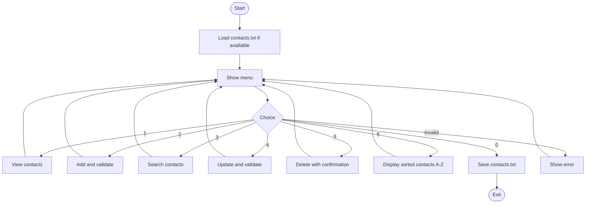

# Contact Management App — Java Workshop

A small Java console contact manager. We agreed on a shared menu and flowchart, while each group member could develop their own version in their own repository. This shared final version uses Tuku's straightforward four-class structure.

## Menu and features

```text
=== CONTACT MANAGEMENT ===
1. View contacts
2. Add contact
3. Search contacts
4. Update contact
5. Delete contact
6. Sort contacts A-Z (Challenge 1)
0. Save and exit (Challenge 3)
```

A contact has an ID, first and last name, phone number and optional email. Contacts are stored in a `LinkedHashMap<Integer, Contact>` (a Java Collection).

**Simple validation:** names and phone are required; phone numbers contain digits with optional `+`, spaces, brackets or hyphens; email is checked only when entered. Duplicate phone numbers and non-empty emails are rejected. Invalid menu options and non-numeric or too-large contact IDs do not crash the program.

## Flowchart



## Project structure

```text
src/main/java/se/lexicon/
  Contact.java           Contact fields and display
  ContactRepository.java LinkedHashMap storage, search, sort and file I/O
  ContactService.java    Simple validation and contact rules
  ContactApp.java        Menu and keyboard input
src/test/java/se/lexicon/
  ContactWorkshopTest.java   JUnit 5 tests for CRUD and sorting
  ContactFileTest.java       JUnit 5 file save/load tests
pom.xml                  Maven config for optional JUnit challenge
FINAL_REPORT.md          Group report
```

## Clone and run

Requires **Java JDK 17 or newer**. Open the cloned folder in IntelliJ IDEA and run `ContactApp.main()`, or use a terminal:

```bash
git clone https://github.com/jackaldzn-blip/contact-management-workshop.git
cd contact-management-workshop
javac -d out src/main/java/se/lexicon/*.java
java -cp out se.lexicon.ContactApp
```

PowerShell users can use IntelliJ's Run button, or replace the wildcard in `javac` with the four explicit Java file paths.

## All three optional challenges

**Challenge 1 — Sorting:** Menu option 6 displays an alphabetical copy, by first and last name. The stored order does not change.

**Challenge 2 — JUnit 5:** Positive and negative tests for add, search, update and delete, plus validation, sorting and file tests. Run on a computer with Maven installed:

```bash
mvn test
```

**Challenge 3 — File I/O:** The application automatically loads `contacts.txt` when it starts, and saves to it when you select 0. Each line is plain text in the format `id|firstName|lastName|phone|email`. The file appears in the folder from which you run the app, and is excluded from Git.

## Manual testing

Janin and Vwselina led the group's manual checks. Anyone can repeat them:

| Action | Expected result |
| --- | --- |
| Add Anna and Omar | Both appear in View |
| Search name or phone | Matching contact appears |
| Update contact by ID | Changed values appear |
| Delete by ID and confirm `yes` | Contact disappears |
| Enter empty name or alphabetic phone | Error shown; no crash |
| Add duplicate phone or non-empty email | Rejected |
| Enter letters or huge number as contact ID | Asked to enter a valid number |
| Add Zara, Anna, Omar and select Sort | Anna, Omar, Zara |
| Exit and run app again | Contacts restored from file |

JUnit is included specifically for Challenge 2; manual checks remain useful.

## Basic Git commands

Get the latest changes before working:

```bash
git switch main
git pull --ff-only origin main
```

After changing and testing your code (requires repository write permission):

```bash
git add .
git commit -m "Describe what you changed"
git push origin main
```

Optional separate feature branch (required for workshop challenges):

```bash
git switch main
git pull --ff-only origin main
git switch -c feature/my-change
# Make your changes, then:
git add .
git commit -m "Describe what you changed"
git push -u origin feature/my-change
```

Open a Pull Request to `main` on GitHub, review it and merge it. The three optional challenges in this shared project were developed through separate branches and pull requests.

See [FINAL_REPORT.md](FINAL_REPORT.md) for the group report.
