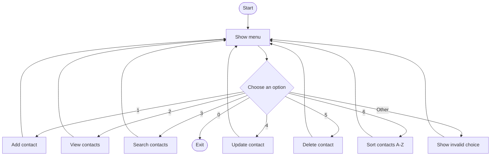

# Contact Management App (Java)

A simple console application for our Java Collections workshop. Everything is in **one Java file**, using an `ArrayList` to store contacts (name, phone, and optional email).

## Features

Add, view, search, update, and delete contacts. **Optional challenge:** display contacts alphabetically (A–Z).

Contacts are stored in memory only and disappear when the application exits.

## App flowchart



## Run the app

Open `src/main/java/se/lexicon/ContactApp.java` in IntelliJ IDEA and run `main()`.

Or use a terminal from the project folder (requires a Java JDK):

```bash
javac -d out src/main/java/se/lexicon/ContactApp.java
java -cp out se.lexicon.ContactApp
```

## Manual testing

Run the program and try:

1. Add Anna with phone `0701111111`, then view the contacts.
2. Search for `ann` and check that Anna appears.
3. Update Anna's name and check the result.
4. Add a second contact using Anna's phone; it should be rejected.
5. Delete a contact and check that it is gone.
6. Add Zara, Anna, and Omar, then use **6. Sort A-Z**; check the alphabetical order.
7. Try an empty name, an unknown phone number, and an invalid menu option.

Testing is **manual**. JUnit and file saving are not included.

## Working with GitHub

**Clone the repository** (once):

```bash
git clone https://github.com/jackaldzn-blip/contact-management-workshop.git
cd contact-management-workshop
```

**Pull the latest changes** before starting work:

```bash
git switch main
git pull --ff-only origin main
```

**Commit and push your changes** (requires collaborator write access):

```bash
git add .
git commit -m "Describe what you changed"
git push origin main
```

**Optional: use a separate branch** for your changes:

```bash
git switch main
git pull --ff-only origin main
git switch -c feature/my-change
# Edit and manually test the code, then:
git add .
git commit -m "Describe what you changed"
git push -u origin feature/my-change
```

On GitHub, open a **Pull Request** from your branch to `main`. After review and merging, run `git switch main` and `git pull --ff-only origin main` again.

Because this project has only one Java file, **agree on who edits each method** to avoid conflicts. The sorting challenge was completed on `feature/sort-contacts` before being merged into `main`.
