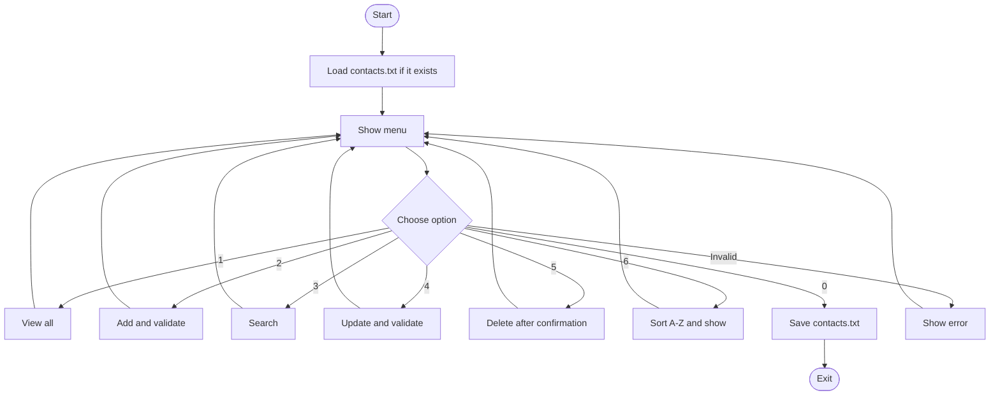

# Understanding Our Contact Management App — Step by Step

**Workshop:** Java Arrays & Collections — Contact Management App  
**Project:** [contact-management-workshop](https://github.com/jackaldzn-blip/contact-management-workshop)  
**Java version:** JDK 17 or newer  
**Guide for:** The current **four-class** application, including all three optional challenges

> **Start here:** You do not need to understand every Java file at once. First understand what a contact is, where it is stored, and how the menu calls the methods. Then learn the challenges one by one.

## 1. What does our program do?

Our program is a small **console contact manager**. A user can add, display, search, update and delete contacts. The application also sorts contacts, tests methods with JUnit 5, and saves contacts to a text file.

This is the **current menu** (note that **1 is View** and **2 is Add**):

```text
=== CONTACT MANAGEMENT ===

1. View contacts
2. Add contact
3. Search contacts
4. Update contact
5. Delete contact
6. Sort contacts A-Z (Challenge 1)
0. Save and exit (Challenge 3)
Choose:
```

Each contact has five values: **ID, first name, last name, phone number, and optional email**.

Example:

```text
ID:          1
First name:  Anna
Last name:   Lee
Phone:       0701111111
Email:       anna@example.com
```

The ID is created automatically. Phone numbers are **String** values, not integers, because phone numbers may start with zero or include a plus sign.

## 2. Why do we have four classes?

The trainer asked us to think about **separation of concerns**: give each class and method a clear responsibility.

| File | Simple explanation |
| --- | --- |
| [`Contact.java`](src/main/java/se/lexicon/Contact.java) | Describes **one contact** |
| [`ContactRepository.java`](src/main/java/se/lexicon/ContactRepository.java) | **Stores** contacts and retrieves, sorts, loads, or saves them |
| [`ContactService.java`](src/main/java/se/lexicon/ContactService.java) | Checks **validation and rules** before making changes |
| [`ContactApp.java`](src/main/java/se/lexicon/ContactApp.java) | Shows the **menu** and reads keyboard input |

We also have two files for **Challenge 2 (JUnit)**, plus `pom.xml`, which tells Maven how to run the JUnit tests. The program is still a small console application: **no database or graphical interface**.

## 3. Complete application flow



The classes work together in this direction:

```text
User types in console
        |
        v
ContactApp        (menu and input)
        |
        v
ContactService    (rules and validation)
        |
        v
ContactRepository (collection and file I/O)
        |
        v
Contact objects   (each person's details)
```

For example, when the user adds a contact, the menu does **not** directly write to the collection. It sends the values to the service, which checks them before calling the repository.

## 4. Contact.java — one person's information

The `Contact` class stores these private fields:

```java
private final int id;
private final String firstName;
private final String lastName;
private final String phone;
private final String email;
```

- `private` means other classes cannot directly change these fields.
- `final` means each field is assigned when the object is created and cannot later be reassigned.
- A **constructor** receives the five values and creates a `Contact` object.
- **Getters**, such as `getFirstName()` and `getPhone()`, allow other classes to read the data.
- `toString()` controls how a contact is printed in the console.

Example:

```java
Contact anna = new Contact(
    1, "Anna", "Lee", "0701111111", "anna@example.com"
);

System.out.println(anna.getFirstName()); // Anna
```

**Important:** Updating a contact does not change those final fields. The repository creates a **new Contact object with the same ID** and replaces the old object in the collection.

## 5. ContactRepository.java — where contacts are kept

The main storage is:

```java
private final Map<Integer, Contact> contacts = new LinkedHashMap<>();
private int nextId = 1;
```

This means:

- `Map<Integer, Contact>` associates each contact's **integer ID** with its `Contact` object.
- `LinkedHashMap` remembers the order in which contacts were added.
- `nextId` starts at 1 and supplies the ID for the next new contact.

Think of it as a table:

| Key (ID) | Value (Contact) |
| --- | --- |
| `1` | Anna Lee, 0701111111 |
| `2` | Omar Ali, 0702222222 |
| `3` | Zara Jones, 0703333333 |

Why use a `LinkedHashMap` instead of an `ArrayList`? Both are legitimate Java Collections. In our shared implementation, a map lets us look up a contact directly using its ID, while preserving entry order. We still use `ArrayList` when we need a **list** for searching and sorting.

### Adding

```java
Contact contact = new Contact(nextId++, firstName, lastName, phone, email);
contacts.put(contact.getId(), contact);
```

`nextId++` uses the current ID, then increases it for the next contact. `put` stores the new object under its ID.

### Viewing and searching

`findAll()` returns a new `ArrayList` of the stored contacts.

`search(query)` loops over contacts and collects those whose first name, last name, or phone contains the search text. Name searches ignore letter case: searching for `ann` can find `Anna`.

### Finding by ID

`findById(id)` returns an `Optional<Contact>`. An Optional represents either a matching contact **or no contact**. That is safer than assuming a contact always exists.

### Updating and deleting

- `update(id, ...)` checks whether the ID exists and whether the new phone or non-empty email would duplicate another contact. It replaces the existing object while keeping the same ID.
- `delete(id)` removes the entry. It returns `true` when a contact was removed and `false` when the ID was unknown.

The repository also provides helper methods `phoneExists(...)` and `emailExists(...)`. Those are used to prevent duplicate details.

## 6. ContactService.java — simple validation

The service sits between the menu and the repository.

When someone adds a contact, the service:

1. Removes extra spaces from the beginning and end of the input.
2. Checks required fields and simple formats.
3. Checks that the phone and any non-empty email are not already used.
4. Calls the repository to save the contact.
5. Returns a success or error message.

The rules are deliberately simple:

| Field or input | Rule |
| --- | --- |
| First name and last name | Required; letters with common spaces, dots, apostrophes or hyphens; no digits |
| Phone | Must have at least 5 digits, and 5–20 characters total; optional leading +, spaces, parentheses and hyphens |
| Email | May be empty; if supplied, must resemble `name@example.com` |
| Duplicate phone | Rejected |
| Duplicate non-empty email | Rejected, ignoring uppercase/lowercase |
| `|` character | Not allowed in contact fields because the file format uses it as a separator |
| Contact ID typed in menu | Must be a positive integer |

This is **basic workshop validation**, not a complete international phone/email validator. For example, names are checked for being non-blank rather than restricted to English letters.

A simplified idea of the check is:

```java
if (first.isBlank() || last.isBlank()) {
    return "First and last name are required.";
}
```

The service returns a small result record:

```java
public record ValidationResult(boolean ok, String message) { }
```

For example, a result can be `(true, "Contact added with id 1")` or `(false, "Phone number already in use.")`. The menu prints the message.

## 7. ContactApp.java — the entry point and menu

Java starts here:

```java
public static void main(String[] args) {
    new ContactApp().runMenu();
}
```

An instance of `ContactApp` creates a service, which in turn receives a repository. The `runMenu()` method first tries to **load existing contacts from the text file**, then repeats the menu inside a `while (true)` loop.

The menu uses a `switch`:

```java
switch (choice) {
    case "1" -> viewContacts(service.list());
    case "2" -> addContact();
    case "3" -> searchContacts();
    case "4" -> updateContact();
    case "5" -> deleteContact();
    case "6" -> viewContacts(service.sorted());
    default -> System.out.println("Please choose a valid option.");
}
```

Option `0` is handled just before the switch: it saves and exits. This way every operation returns to the menu until the user exits.

### Reading keyboard input

`Scanner` reads what the user types:

```java
private String readLine(String prompt) {
    System.out.print(prompt);
    return SCANNER.hasNextLine() ? SCANNER.nextLine().trim() : null;
}
```

`nextLine()` reads a full line; `trim()` removes surrounding spaces. The `hasNextLine()` check also handles an ended input stream.

### Validating a typed contact ID

`promptId()` uses `Integer.parseInt()` inside a `try/catch`. If the user types letters, a negative number, or an impossibly large number, the program asks again instead of crashing.

### Updating and deleting from the menu

For update, the user enters an ID and may press Enter on a field to **keep its current value**. The service then checks the new values.

For delete, the user enters an ID and must type `yes` to confirm. Anything else cancels deletion.

## 8. Example: adding one contact step by step

Imagine the user selects `2. Add contact` and types:

```text
First name: Anna
Last name: Lee
Phone: 0701111111
Email (optional): anna@example.com
OK: Contact added with id 1
```

What happened?

1. `ContactApp.addContact()` read the four values.
2. `ContactService.add(...)` checked for missing values, invalid formats and duplicates.
3. `ContactRepository.add(...)` created a new `Contact` with ID 1.
4. The repository put it in the `LinkedHashMap`.
5. The service returned a successful `ValidationResult`.
6. The console displayed the message and then showed the menu again.

This **menu → service → repository → contact** pattern is the most important idea to understand.

## 9. Example: search, update and delete

**Search:** Option 3 asks for part of a name or phone number. The repository checks each stored contact and returns a list of matches.

**Update:** Option 4 asks for an existing ID, such as `1`. The user can change the name or phone while leaving other fields blank. The old contact is replaced with a new object **using the same ID**.

**Delete:** Option 5 asks for the ID, requests confirmation with `yes`, then removes the contact. Searching for that ID afterward finds nothing.

These methods reuse the same repository and validation logic. That avoids copying the same checks into every menu option.

## 10. Challenge 1 — alphabetical sorting

Option `6` displays the contacts in alphabetical order by **first name, then last name**.

The key part in `ContactRepository.java` is:

```java
List<Contact> sorted = findAll();
sorted.sort(Comparator.comparing(
        Contact::getFirstName, String.CASE_INSENSITIVE_ORDER)
        .thenComparing(Contact::getLastName, String.CASE_INSENSITIVE_ORDER));
return sorted;
```

Why create `sorted`? We sort a **copy** of the contacts. The original `LinkedHashMap` keeps its insertion order.

Example:

| Order added | Option 6: A–Z |
| --- | --- |
| Zara Jones | Anna Lee |
| Anna Lee | Omar Ali |
| Omar Ali | Zara Jones |

`Comparator` tells Java how to compare two contacts; `String.CASE_INSENSITIVE_ORDER` ignores uppercase/lowercase when comparing the names.

## 11. Challenge 2 — JUnit 5 tests

**Padma worked on Challenge 2**, which asks for unit tests for the data-access operations.

The tests are in:

- [`ContactWorkshopTest.java`](src/test/java/se/lexicon/ContactWorkshopTest.java) — add, search, update, delete, validation and sorting.
- [`ContactFileTest.java`](src/test/java/se/lexicon/ContactFileTest.java) — file saving and loading.

JUnit uses `@Test` to mark a test method. For example:

```java
@Test
void repositoryDelete_negativeUnknownId() {
    assertFalse(repository.delete(99));
}
```

Here `assertFalse` means the test passes only if attempting to delete an unknown ID returns false.

Challenge 2 asks for **positive and negative** tests for each data-access operation:

| Operation | Positive test | Negative test |
| --- | --- | --- |
| Add | Valid contact is stored | Duplicate phone is rejected |
| Search | Existing contact is found | Unknown query returns empty list |
| Update | Existing contact is changed | Unknown ID cannot be updated |
| Delete | Existing contact is deleted | Unknown ID cannot be deleted |

The project contains **27 methods marked `@Test`** across the two files. This is the number of test cases *written*, **not a claim that all have passed**.

To run the suite on a machine with Maven installed:

```bash
mvn test
```

If using IntelliJ IDEA, you can also import the Maven project and run the JUnit test classes. Record the actual passing/failing results after running them. Manual console testing is useful too, but it is **not** a substitute for running the JUnit suite when reporting Challenge 2 as verified.

## 12. Challenge 3 — saving and loading contacts

**Tuku worked on Challenge 3**, which adds simple **plain-text file I/O**.

Without saving, contacts would disappear when the application closed. Our current program:

- **Loads** `contacts.txt` automatically at startup, if the file exists.
- **Saves** all contacts to `contacts.txt` when the user chooses option `0`.
- Starts with an empty collection if no file exists yet.

One contact is saved per line:

```text
1|Anna|Lee|0701111111|anna@example.com
2|Omar|Ali|0702222222|
```

The `|` character separates the fields. An empty final field represents an optional email.

In the repository, `saveToFile(Path path)` uses `Files.write(...)`. `loadFromFile(Path path)` uses `Files.readAllLines(...)`, splits each line, constructs contacts and restores their IDs. It also adjusts `nextId` so the next new contact receives a new ID.

**Where is the file?** Usually in the folder from which you start the Java program. It is ignored by Git so personal contact data is not automatically committed.

If the file exists but is malformed, startup displays an error and stops instead of overwriting it.

**Important limitation:** Saving occurs on normal exit through option 0 (or end-of-input). Unexpected termination may lose changes made since the last save. This is acceptable for this small workshop.

## 13. Manual testing — a practice checklist

**Jay and Veselina** led the group's manual testing. Repeat these scenarios on the current version:

| What you do | What should happen |
| --- | --- |
| Choose 1 when no contacts exist | “No contacts found.” |
| Choose 2 and add Anna Lee | New ID and success message |
| Add another contact with Anna's phone | Duplicate phone rejected |
| Enter an empty last name | Name required error |
| Enter phone `abcd` | Invalid phone error |
| Enter optional email `wrong` | Invalid email error |
| Choose 3 and search `ann` | Anna appears |
| Choose 4 and change Anna's name | New name shown; same ID |
| Choose 5 and type anything except `yes` | Delete cancelled |
| Choose 5 and type `yes` | Contact removed |
| Add Zara, Anna, Omar, then choose 6 | Anna, Omar, Zara |
| Enter letters or a very large ID | Error shown, asks for ID again |
| Choose 0, then run the app again | Saved contacts load |

The table shows **expected results** so you can perform and document testing; it is not a new execution log.

## 14. Run the current application

**Using IntelliJ IDEA:** Clone the repository, open the project folder, and run `ContactApp.main()`.

**Using the terminal:** Install **JDK 17+** and run these commands from the repository root:

```bash
git clone https://github.com/jackaldzn-blip/contact-management-workshop.git
cd contact-management-workshop
javac -d out src/main/java/se/lexicon/*.java
java -cp out se.lexicon.ContactApp
```

The `javac` command compiles the four Java classes into `out`. The next line starts the app.

With Maven installed, run `mvn test` to execute Challenge 2's unit tests. See the [README](README.md) for Git pull, push and branch commands.

## 15. Important Java concepts to explain to the trainer

| Concept | Where we see it |
| --- | --- |
| Class and object | `Contact` and `new Contact(...)` |
| Constructor and getters | `Contact.java` |
| Encapsulation | `private final` fields |
| Collection | `LinkedHashMap<Integer, Contact>` |
| List | `ArrayList<Contact>` results |
| Loop | `while` menu and `for` search |
| Selection | `switch` and `if` |
| Methods | `add`, `search`, `update`, `delete` |
| Return values | `boolean`, `Optional<Contact>`, `List<Contact>` |
| Validation | `ContactService.validate(...)` |
| Sorting | `Comparator` and `sort()` |
| File I/O | `Files.write` / `Files.readAllLines` |
| Unit testing | JUnit `@Test` and assertions |

**Best learning order:** Understand **Contact → Repository → Service → App**, then practise **Add → View → Search → Update → Delete**, then study **Sorting → JUnit → File I/O**. You only need to learn one part at a time.
