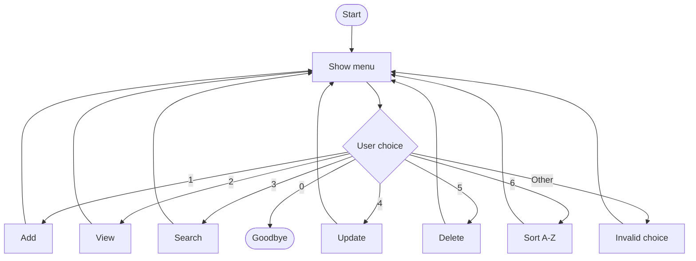

# Understanding Our Contact Management App — Step by Step

**Workshop:** Java Arrays & Collections — Contact Management App  
**Project repository:** [contact-management-workshop](https://github.com/jackaldzn-blip/contact-management-workshop)  
**Application source:** [`src/main/java/se/lexicon/ContactApp.java`](https://github.com/jackaldzn-blip/contact-management-workshop/blob/main/src/main/java/se/lexicon/ContactApp.java)

## What does the application do?

Our program is a **console-based contact manager**. It lets a user:

- **1** — Add a contact.
- **2** — View all contacts.
- **3** — Search by name or phone number.
- **4** — Update an existing contact.
- **5** — Delete a contact.
- **6** — Sort contacts alphabetically (**Challenge 1**).
- **0** — Exit the application.

Each contact has a **name**, **phone number**, and **optional email address**. The program uses **one Java source file** and an `ArrayList<Contact>` to hold contacts while it is running.

The main idea is simple: the user chooses an option, Java calls the matching method, and the method reads or changes the contacts list.



---

## 1. Package and imports

```java
package se.lexicon;

import java.util.ArrayList;
import java.util.List;
import java.util.Scanner;
```

- `package se.lexicon;` identifies the Java package. The file is stored in `src/main/java/se/lexicon/`.
- `ArrayList` is a resizable collection that holds our contacts.
- `List` is the interface used to describe that collection.
- `Scanner` reads text entered by the user in the console.

**Remember:** We use a phone number as a `String`, not an `int`, because phone numbers may begin with `0` and are not numbers we calculate with.

## 2. The `Contact` class — one contact

Inside `ContactApp`, we declare a **static nested class** called `Contact`:

```java
static class Contact {
    String name;
    String phone;
    String email;

    Contact(String name, String phone, String email) {
        this.name = name;
        this.phone = phone;
        this.email = email;
    }

    @Override
    public String toString() {
        return name + " | " + phone + " | " + email;
    }
}
```

### What do the fields represent?

- `name` stores the person's name.
- `phone` stores their phone number.
- `email` stores their email address, if provided.

### What is a constructor?

The constructor runs when we create a new contact:

```java
Contact anna = new Contact("Anna", "0701234567", "anna@example.com");
```

`this.name = name;` means: store the supplied `name` argument in the `name` field of **this particular contact object**. The same idea applies to `phone` and `email`.

### What does `toString()` do?

`toString()` tells Java how to represent an object as text. With our override:

```java
System.out.println(anna);
```

Output:

```text
Anna | 0701234567 | anna@example.com
```

Without this override, printing the object would usually show a class name and an object identifier instead of useful contact details.

## 3. Where do contacts live?

```java
static List<Contact> contacts = new ArrayList<>();
static Scanner scanner = new Scanner(System.in);
```

- `contacts` begins as an **empty ArrayList**. It can hold many `Contact` objects.
- `scanner` lets our program read input typed into the console.
- Both variables are `static`, so our static methods can use them directly.

For example, after adding three contacts, the list could look like this:

| Index | Name | Phone |
|---|---|---|
| `0` | Zara | `0703333333` |
| `1` | Anna | `0701111111` |
| `2` | Omar | `0702222222` |

**Important:** ArrayList indexes start at **0**, and our program stores data **in memory only**. Contacts are lost when the program ends; saving to a file is not part of this version.

## 4. `main()` — where the program starts

```java
public static void main(String[] args) {
    boolean running = true;

    while (running) {
        showMenu();
        String choice = scanner.nextLine();

        switch (choice) {
            case "1": addContact(); break;
            case "2": viewContacts(); break;
            case "3": searchContacts(); break;
            case "4": updateContact(); break;
            case "5": deleteContact(); break;
            case "6": sortContacts(); break;
            case "0": running = false; break;
            default: System.out.println("Please choose a valid option.");
        }
    }

    System.out.println("Goodbye!");
}
```

The execution order is:

1. `boolean running = true;` tells the application to keep going.
2. `while (running)` repeatedly runs the menu and choice logic.
3. `showMenu()` displays the available operations.
4. `scanner.nextLine()` waits for the user to enter a choice.
5. `switch (choice)` calls the corresponding method.
6. Choosing `"0"` changes `running` to `false`, ending the loop.
7. The program prints `Goodbye!`.

`break` ends a `switch` case. It does **not** exit the outer `while` loop. The loop continues until the user chooses `0`.

## 5. `showMenu()` — printing the choices

```java
static void showMenu() {
    System.out.println("\n=== CONTACT MANAGEMENT ===");
    System.out.println("1. Add contact");
    System.out.println("2. View contacts");
    System.out.println("3. Search contacts");
    System.out.println("4. Update contact");
    System.out.println("5. Delete contact");
    System.out.println("6. Sort A-Z (challenge)");
    System.out.println("0. Exit");
    System.out.print("Choose: ");
}
```

This method has **one job**: display the menu. It does not add, delete, or search for a contact.

- `static` means the method can be called by `main()` without creating a `ContactApp` object.
- `void` means the method does not return a value.
- `\n` starts a new line before the heading.
- `print()` leaves the cursor on the same line for the user's input.

## 6. `addContact()` — creating and saving a contact

```java
static void addContact() {
    System.out.print("Name: ");
    String name = scanner.nextLine().trim();
    System.out.print("Phone: ");
    String phone = scanner.nextLine().trim();
    System.out.print("Email (optional): ");
    String email = scanner.nextLine().trim();

    if (name.isEmpty() || phone.isEmpty()) {
        System.out.println("Name and phone are required.");
        return;
    }
    if (findByPhone(phone) != null) {
        System.out.println("That phone number already exists.");
        return;
    }
    contacts.add(new Contact(name, phone, email));
    System.out.println("Contact added!");
}
```

**Step A — Read input.** `scanner.nextLine()` reads text, and `.trim()` removes surrounding spaces.

**Step B — Validate required fields.**

```java
if (name.isEmpty() || phone.isEmpty())
```

`||` means **OR**: reject the contact if either the name or phone number is blank. `return;` stops the method early.

**Step C — Reject duplicates.**

```java
if (findByPhone(phone) != null)
```

This checks whether a contact with that phone number already exists. `null` means no matching contact was found.

**Step D — Add to the collection.**

```java
contacts.add(new Contact(name, phone, email));
```

`new Contact(...)` constructs the object and `.add(...)` places that object in the ArrayList.

**Example:** Enter `Anna`, `0701111111`, and `anna@example.com`. The program prints `Contact added!`.

## 7. `viewContacts()` — displaying the list

```java
static void viewContacts() {
    printContacts(contacts);
}
```

This method passes the whole list to `printContacts()`, which is responsible for formatting and displaying the results.

**Why use a helper?** Searching and sorting also need to display lists. Reusing the same `printContacts()` method avoids repeating display code.

## 8. `searchContacts()` — finding matching contacts

```java
static void searchContacts() {
    System.out.print("Search by name or phone: ");
    String query = scanner.nextLine().trim().toLowerCase();
    List<Contact> matches = new ArrayList<>();

    for (Contact contact : contacts) {
        if (contact.name.toLowerCase().contains(query)
                || contact.phone.contains(query)) {
            matches.add(contact);
        }
    }
    printContacts(matches);
}
```

How searching works:

1. Ask the user for a search term.
2. Convert the input to lowercase to help match names without case sensitivity.
3. Make a new, empty list called `matches`.
4. Loop over each stored contact using an **enhanced `for` loop**.
5. Check whether the name or phone number **contains** the search text.
6. Add matching contacts to `matches` and display that list.

For example, searching for `ann` will find `Anna`.

```java
for (Contact contact : contacts)
```

means: “For every contact in `contacts`, temporarily refer to the current one as `contact`.”

**Note:** An empty search query matches every contact, because every string contains `""`. This simple version does not reject empty searches.

## 9. `updateContact()` — changing existing information

```java
static void updateContact() {
    System.out.print("Phone number of contact to update: ");
    Contact contact = findByPhone(scanner.nextLine().trim());
    if (contact == null) {
        System.out.println("Contact not found.");
        return;
    }

    System.out.print("New name (Enter to keep): ");
    String name = scanner.nextLine().trim();
    System.out.print("New phone (Enter to keep): ");
    String phone = scanner.nextLine().trim();
    System.out.print("New email (Enter to keep): ");
    String email = scanner.nextLine().trim();

    if (!phone.isEmpty() && !phone.equals(contact.phone)
            && findByPhone(phone) != null) {
        System.out.println("That phone number already exists.");
        return;
    }
    if (!name.isEmpty()) contact.name = name;
    if (!phone.isEmpty()) contact.phone = phone;
    if (!email.isEmpty()) contact.email = email;
    System.out.println("Contact updated!");
}
```

How it works:

1. Find the existing contact by its current phone number.
2. If there is no match, show `Contact not found.` and stop.
3. Ask for replacement values.
4. If a new phone number was entered, verify that it is not used by another contact.
5. Change only fields for which the user entered new text.

The `!` operator means **NOT**, so `!name.isEmpty()` means the input is not empty. The `&&` operator means **AND**: all its conditions must be true.

**Example:** Search for `0701111111`, enter `Maria` as the new name, and press Enter for the new phone and email. Only the name changes.

**Small limitation:** Pressing Enter for email keeps the old email; there is no special command to erase an existing email value.

## 10. `deleteContact()` — removing a contact

```java
static void deleteContact() {
    System.out.print("Phone number to delete: ");
    Contact contact = findByPhone(scanner.nextLine().trim());
    if (contact == null) {
        System.out.println("Contact not found.");
        return;
    }
    contacts.remove(contact);
    System.out.println("Contact deleted!");
}
```

First, the method finds a contact by phone number. If it exists, the method uses:

```java
contacts.remove(contact);
```

to remove that object from the ArrayList. `ArrayList` automatically updates its indexes after removal.

## 11. `sortContacts()` — optional Challenge 1

```java
static void sortContacts() {
    List<Contact> sorted = new ArrayList<>(contacts);
    sorted.sort((first, second) ->
            first.name.compareToIgnoreCase(second.name));
    printContacts(sorted);
}
```

This is our **additional workshop challenge**: display contacts in alphabetical order.

**First**, create a new list:

```java
List<Contact> sorted = new ArrayList<>(contacts);
```

This creates a separate ArrayList containing references to the same contact objects. Sorting this new list changes its **order**, but not the order of the original `contacts` list.

**Next**, sort by name:

```java
sorted.sort((first, second) ->
        first.name.compareToIgnoreCase(second.name));
```

The expression `(first, second) -> ...` is a **lambda** that provides a comparison rule for sorting. `compareToIgnoreCase` compares the two names without treating uppercase and lowercase letters as different.

**Finally**, display the sorted list using `printContacts(sorted)`.

| Order contacts were added | Displayed by Sort A–Z |
|---|---|
| Zara | Anna |
| Anna | Omar |
| Omar | Zara |

We added Challenge 1 without needing a database, file saving, or a JUnit testing framework.

## 12. Helper method: `findByPhone()`

```java
static Contact findByPhone(String phone) {
    for (Contact contact : contacts) {
        if (contact.phone.equals(phone)) return contact;
    }
    return null;
}
```

This method loops through the list and checks each contact's phone number.

- If it finds an exact match, it **returns that `Contact` object**.
- If it reaches the end without a match, it returns `null`.

Because its return type is `Contact`, it returns an object (or `null`), unlike a `void` method.

This helper is reused by **add**, **update**, and **delete**.

## 13. Helper method: `printContacts()`

```java
static void printContacts(List<Contact> list) {
    if (list.isEmpty()) {
        System.out.println("No contacts found.");
        return;
    }
    for (Contact contact : list) {
        System.out.println(contact);
    }
}
```

The method accepts **any `List<Contact>`** and displays its contents.

- `list.isEmpty()` checks whether there is nothing to print.
- The enhanced `for` loop visits each contact.
- `System.out.println(contact)` automatically calls the `Contact` object's `toString()` method.

It is shared by **view**, **search**, and **sort**.

---

## 14. Practice walkthrough: follow the data

Run the program and follow this sequence:

**Step 1 — Add contacts.**

```text
Choose: 1
Name: Zara
Phone: 0703333333
Email (optional): zara@example.com
Contact added!
```

Repeat option 1 to add Anna and Omar with different phone numbers.

**Step 2 — View the original order.**

```text
Choose: 2
Zara | 0703333333 | zara@example.com
Anna | 0701111111 | anna@example.com
Omar | 0702222222 | omar@example.com
```

**Step 3 — Sort the display.**

```text
Choose: 6
Anna | 0701111111 | anna@example.com
Omar | 0702222222 | omar@example.com
Zara | 0703333333 | zara@example.com
```

**Step 4 — View again.** Choose option 2. The original insertion order still appears because `sortContacts()` sorted a copy.

**Step 5 — Search.** Choose option 3, type `ann`, and see Anna's contact.

**Step 6 — Update and delete.** Choose option 4 to rename Anna, then option 5 to delete a contact by its phone number.

## 15. Manual testing: what should we check?

Our workshop uses **manual testing**, not JUnit. We run the application, enter test data, and compare the output to what we expect.

| Test | Action | Expected result |
|---|---|---|
| Add | Add Anna with a unique phone | `Contact added!` |
| View | View after adding Anna | Anna appears |
| Search | Search `ann` | Anna appears |
| Update | Rename Anna to Maria | The updated contact appears |
| Delete | Delete Maria by phone | Contact is removed |
| Duplicate phone | Add another contact with an existing phone | Duplicate rejected |
| Empty name | Try to add a contact without a name | Required-fields message |
| Unknown phone | Update or delete a number not in the list | `Contact not found.` |
| Sort A–Z | Add Zara, Anna, Omar; choose option 6 | Anna, Omar, Zara |
| Invalid menu choice | Enter `9` | Valid-option message; menu continues |
| Exit | Enter `0` | `Goodbye!` |

**Do not mark a test as passed until someone in the group actually performs it.** Record who tested it and whether the observed result matched the expected one.

## 16. Java concepts to explain to the trainer

| Concept | Where to find it |
|---|---|
| Package and imports | `package` / `import` lines |
| Class and object | `Contact` / `new Contact(...)` |
| Constructor | `Contact(String name, String phone, String email)` |
| ArrayList | `new ArrayList<>()` |
| Methods | `addContact()`, `searchContacts()`, etc. |
| `while` loop | Repeats the menu |
| `switch` | Selects the requested operation |
| Enhanced `for` loop | Search and printing |
| `if` statements | Required fields, duplicates, not-found checks |
| `.add()` and `.remove()` | Saving and deleting from the list |
| `.sort()` and lambda | Alphabetical sorting challenge |
| `return` / `null` | `findByPhone()` and early exits |
| Code reuse | `findByPhone()` and `printContacts()` |

### Questions to discuss together

1. Why do we store phone numbers as `String` instead of `int`?
2. What is the difference between a `Contact` object and `List<Contact>`?
3. Why do we check for duplicate phone numbers before adding a contact?
4. What happens when `findByPhone()` does not find a contact?
5. Why do `viewContacts()`, `searchContacts()`, and `sortContacts()` all use `printContacts()`?
6. Why do we sort a **copy** of the list in Challenge 1?
7. What happens to contacts after the program closes?

**Learning order:** Begin with `Contact`, `contacts`, `addContact()`, `findByPhone()`, and `printContacts()`. Once these are clear, the menu and the remaining methods are much easier to follow.

---

**Run the application** in IntelliJ IDEA by opening `ContactApp.java` and running its `main()` method, or use the commands in the [project README](https://github.com/jackaldzn-blip/contact-management-workshop/blob/main/README.md).
